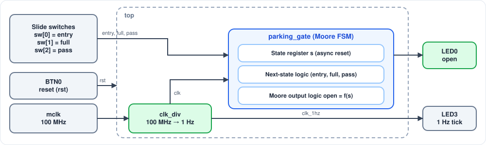

# SmartPark: FPGA-Based Automatic Parking Gate Controller Using Moore FSM

## 📌 Overview

A parking gate must determine whether to open or remain closed for each approaching vehicle. This decision depends on whether the vehicle is entering or exiting and whether parking space is available. Once the gate opens, it remains open until the vehicle passes, after which it closes before handling the next vehicle.

This project implements an automatic parking gate controller using a **four-state Moore Finite State Machine (FSM)**. The four states are S0 (IDLE), S1 (OPEN1), S2 (OPEN2), and S3 (CLOSE). Exit vehicles are always allowed, while entry is permitted only when `full = 0`. If the parking area is full (`full = 1`), the FSM remains in IDLE and the gate stays closed. The gate remains open until the `pass` input indicates that the vehicle has cleared it.

The design demonstrates structured RTL development using Verilog, including state encoding, Moore output logic, and a three-block FSM coding style consisting of the state register, next-state logic, and output logic. The design is verified through a Verilog testbench using simulation.

## 📋 Project Specifications

| Parameter | Description |
|---|---|
| Project Name | SmartPark |
| Vehicles Handled | One vehicle at a time |
| Number of States | 4 (S0–IDLE, S1–OPEN1, S2–OPEN2, S3–CLOSE) |
| FSM Type | Moore FSM |
| Inputs | `entry`, `full`, `pass` |
| Output | `open` (1 = gate open, 0 = gate closed) |
| Reset | Asynchronous, active-high (`rst`) |
| Detect-to-Open Latency | 1 clock cycle when the FSM is in IDLE |
| Pass-to-Close Latency | 1 clock cycle after `pass` is sampled HIGH |
| Parking Policy | Entry blocked when full; exit always allowed |
| Board | RealDigital Boolean Board |
| FPGA Family | Xilinx Spartan-7 |
| FPGA Part Number | xc7s50csga324-1 |
| HDL | Verilog |
| Simulation Tool | Vivado Simulator |
| Top Module | `top` |
| FSM Module | `parking_gate` |
| Clock Divider Module | `clk_div` |

## ✨ Features

- Four-state Moore Finite State Machine.
- Separate entry and exit handling.
- Checks parking availability before allowing entry.
- Allows exit even when the parking area is full.
- Keeps the gate open until the vehicle passes.
- Asynchronous active-high reset.
- Clock divider for visible LED indication on the FPGA board.

## 🧱 System Architecture

The FPGA clock is divided down to 1 Hz so that state changes are visible on the LEDs. The slide switches represent the vehicle detection and parking status inputs, while an LED indicates the gate output.

### System Block Diagram

### Circuit Schematic

## ⚙️ Working Principle

1. The FSM starts in the IDLE state (S0), with the gate closed.
2. When an exit vehicle arrives, the FSM moves to OPEN1 (S1).
3. When an entry vehicle arrives and parking space is available, the FSM moves to OPEN2 (S2).
4. If parking is full, entry is not allowed.
5. In S1 or S2, the gate remains open until the `pass` signal becomes HIGH.
6. Once the vehicle passes, the FSM moves to CLOSE (S3), closing the gate.
7. The FSM then returns to IDLE (S0).

The FSM control logic is implemented in the `parking_gate` module.

## 🧠 FSM Design

### FSM State Diagram

### State Encoding and Outputs

| State | Name | Encoding | open | Description |
|---|---|---|---|---|
| S0 | IDLE | 2'b00 | 0 | Gate closed |
| S1 | OPEN1 | 2'b01 | 1 | Gate open for exit |
| S2 | OPEN2 | 2'b10 | 1 | Gate open for entry |
| S3 | CLOSE | 2'b11 | 0 | Gate closed |

### FSM Transition Table

| Current State | Condition | Next State | Description |
|---|---|---|---|
| S0 | `entry = 0` | S1 | Exit vehicle; `full` is ignored |
| S0 | `entry = 1`, `full = 0` | S2 | Entry allowed |
| S0 | `entry = 1`, `full = 1` | S0 | Entry blocked |
| S1 | `pass = 0` | S1 | Vehicle still passing |
| S1 | `pass = 1` | S3 | Vehicle passed |
| S2 | `pass = 0` | S2 | Vehicle still passing |
| S2 | `pass = 1` | S3 | Vehicle passed |
| S3 | Always | S0 | Return to IDLE |

### Input Usage by State

| State | entry | full | pass |
|---|---|---|---|
| S0 | Used | Used only when `entry = 1` | Ignored |
| S1 | Ignored | Ignored | Used |
| S2 | Ignored | Ignored | Used |
| S3 | Ignored | Ignored | Ignored |

## 🔍 Design Properties

- **Moore Output:** The output `open` depends only on the current state.
- **Exit Priority:** Exit vehicles are always allowed, even when parking is full.
- **Entry Control:** Entry is allowed only when `full = 0`.
- **One Vehicle at a Time:** Once the FSM leaves S0, it ignores `entry` and `full` until the current vehicle has passed and the gate has closed.
- **No Separate Car-Present Input:** In S0, `entry = 0` represents an exit request.
- **Asynchronous Reset:** The reset immediately forces the FSM to S0.
- **Default State Recovery:** Unexpected state values return the FSM to S0.

## 🔍 Typical Operation Walkthrough

The waveform below follows one exit vehicle, one entry vehicle, and an entry attempt while the parking area is full.

### Timing Diagram

The simulation begins with an entry request while the parking area is full, so the FSM remains in S0. Next, an exit vehicle arrives and the FSM moves to S1, opening the gate even though the parking area is full.

When `pass` becomes HIGH, the FSM moves to S3 at the next rising clock edge, closing the gate. At the following rising edge, it returns to S0.

An entry vehicle then arrives while parking space is available, so the FSM moves to S2 and opens the gate. After the vehicle passes, the FSM follows the same S2 → S3 → S0 sequence.

Finally, another entry request is blocked because the parking area is full.

### Simulation Sequence

| Cycle | entry | full | pass | State | open | What Happened |
|---|---|---|---|---|---|---|
| T0 | 1 | 1 | 0 | S0 | 0 | Entry vehicle, parking full, blocked |
| T1 | 0 | 1 | 0 | S0 | 0 | Exit request; next state becomes S1 |
| T2 | 0 | 1 | 0 | S1 | 1 | Gate open; vehicle passing |
| T3 | 0 | 1 | 1 | S1 | 1 | Pass signal asserted |
| T4 | 1 | 0 | 0 | S3 | 0 | Gate closed |
| T5 | 1 | 0 | 0 | S0 | 0 | Entry request; next state becomes S2 |
| T6 | 1 | 0 | 0 | S2 | 1 | Gate open; vehicle passing |
| T7 | 1 | 0 | 1 | S2 | 1 | Pass signal asserted |
| T8 | 0 | 0 | 0 | S3 | 0 | Gate closed |
| T9 | 1 | 1 | 0 | S0 | 0 | Entry request blocked because parking is full |

## 💻 RTL Design and Implementation

The FSM is implemented using the standard three-block coding style:

1. **State Register:** Updates the current state on every rising clock edge and handles asynchronous reset.
2. **Next-State Logic:** Determines the next state based on the current state and input conditions.
3. **Output Logic:** Generates the gate output based only on the current state.

### Verilog Code
module parking_gate(open,entry,full,pass,clk,rst);
input clk,rst,entry,full,pass;
output reg open;

 localparam 
S0 = 2'b00, 
S1 = 2'b01,
S2 = 2'b10,
S3 = 2'b11;   
reg [1:0] s,ns;

 always @(posedge clk or posedge rst)
 begin
 if (rst)
   s <= S0;
 else
   s <= ns;
 end
always @(*) 
begin
 ns = s;
if (s == S0) 
begin
  if (entry == 1'b0)
 begin
    ns = S1;
 end

 else if (full == 1'b0)
 begin
    ns = S2;
  end
  else 
begin
    ns = S0;
 end
end
 
else if (s == S1) 
begin
 if (pass == 1'b0) 
begin
     ns = S1;
   end
  else
 begin
     ns = S3;
 end
  end

 else if (s == S2)
 begin
  if (pass == 1'b0)
 begin
      ns = S2;
 end
  else 
begin
     ns = S3;
 end
end

 else if (s == S3) 
begin
    ns = S0;
 end

 else 
begin
    ns = S0;
end

end

 always @(*)
 begin
 if (s == S0)
     open = 1'b0;
else if (s == S1)
    open = 1'b1;
 else if (s == S2)
    open = 1'b1;
else if (s == S3)
    open = 1'b0;
else
   open = 1'b0;
end
endmodule

## Simulation Results

The FSM behaviour was verified using a Verilog testbench in Vivado Simulator.

The simulation checks:

- Reset operation.
- Entry when parking is full.
- Entry when parking space is available.
- Exit operation when parking is full.
- Gate remaining open until the vehicle passes.
- Gate closing and returning to IDLE.

## 📁 Repository Structure

parking-gate-fsm/
│
├── Images/
│   ├── Schematic diagram.png
│   ├── Timing diagram.png
│   ├── block_diagram.svg
│   └── state diagram.png
│
├── RTL/
│   ├── clk_div.v
│   ├── parking_gate.v
│   └── top.v
│
├── Stimulation/
│   └── parking_gate tb.v
│
└── README.md

## 🔭 Future Enhancements

- Implement an automatic vehicle counter to track the number of entering and exiting vehicles.
- Support simultaneous entry and exit operations using two independent FSMs with a shared parking counter.
- Introduce a timeout mechanism to close the gate if a vehicle does not pass within a specified time.
- Add a separate `car_present` input to distinguish vehicle detection from entry and exit requests.
- Display the current FSM state and available parking slots on a seven-segment display.
- Develop a self-checking testbench to compare actual FSM outputs and state transitions against expected results.
- Perform formal verification using SymbiYosys.
- Include FPGA resource utilization and timing analysis results for the Xilinx Spartan-7 device.
## 🎯 Key Learning Outcomes

This project demonstrates the practical application of Finite State Machines in digital system design. It highlights the process of converting real-world requirements into state transitions, implementing a Moore FSM using Verilog, selecting appropriate state encoding, and designing reliable RTL using a structured three-block coding style.

It also demonstrates the importance of testbench development, reset handling, clock synchronization, and simulation-based verification in digital design.
## 👤 Author

**KAVIYASRI N**

Electronics and Communication Engineering  
Bannari Amman Institute of Technology
## 🔗 GitHub 

https://github.com/kaviyasrinandhagobal-png
